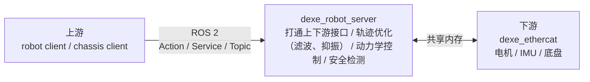
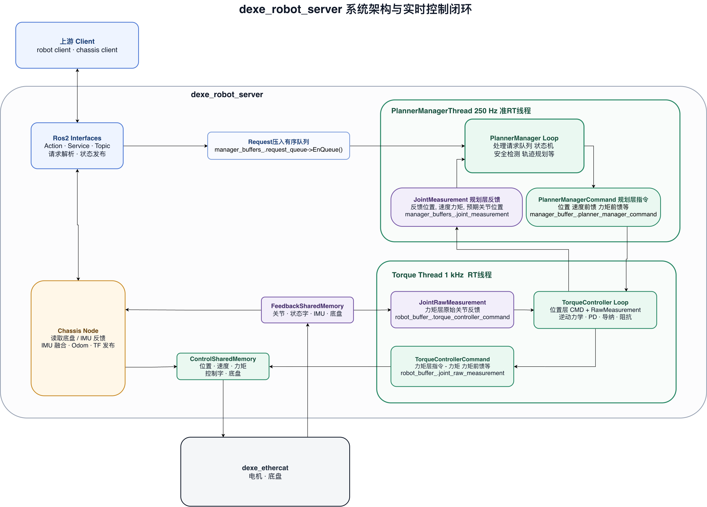
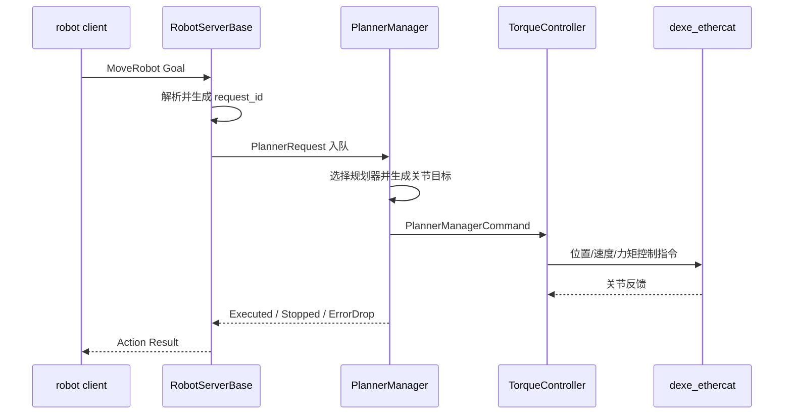
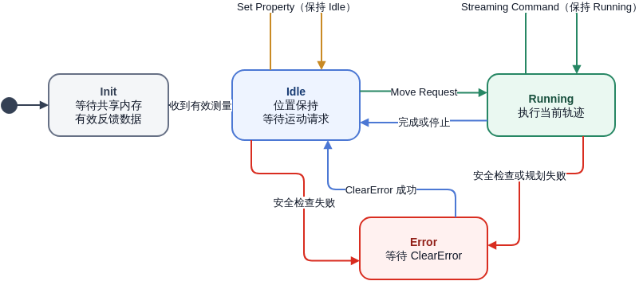

# dexe_robot_server 设计文档

## 1. 系统概览

### 1.1 系统功能定位

dexe_robot_server 是 W1 双臂移动机器人的实时控制服务，位于 robot client 与 dexe_ethercat 之间。

主要职责：

1. 接收关节、末端位姿、轨迹及底盘控制请求。
2. 完成轨迹生成与优化（滤波、抑振）、运动学、动力学控制和安全检测。
3. 以 1 kHz 频率与 dexe_ethercat 交换反馈和控制指令。
4. 发布关节状态、机器人状态、IMU、里程计和 TF。
5. 提供与真机接口基本一致的仿真服务。



### 1.2 目录概览

| 目录 | 作用 |
|---|---|
| [`robot_server_lib`](../robot_server_lib/) | 通用核心库：状态机、规划器、运动学、动力学、控制器、安全检查 |
| [`robot_server_lib/utils`](../robot_server_lib/utils/) | 通用数据结构、线程通信队列、配置解析、安全检测、滤波、日志和传感器工具 |
| [`w1_server`](../w1_server/) | 真机适配：共享内存、关节映射、控制字、底盘和 IMU |
| [`sim_server`](../sim_server/) | 仿真适配：位置闭环和可选正动力学仿真 |
| [`script`](../script/) | 可视化、标定、日志分析和辅助工具 |

### 1.3 关键文件

| 目录/模块 | 关键文件 | 作用 |
|---|---|---|
| [`robot_server_lib/src`](../robot_server_lib/src/) | [`robot_server_base.cpp`](../robot_server_lib/src/robot_server_base.cpp)<br>[`planner_manager.cpp`](../robot_server_lib/src/planner_manager.cpp)<br>[`torque_controller_manager.cpp`](../robot_server_lib/src/torque_controller_manager.cpp) | ROS 2 公共接口及线程入口<br>规划状态机、请求调度和规划器管理<br>力矩控制状态机及控制器调度 |
| [`robot_server_lib/motion_planner`](../robot_server_lib/motion_planner/) | [`move_planner_base.cpp`](../robot_server_lib/motion_planner/move_planner_base.cpp) | 定义运动规划器公共接口、生命周期和基础行为 |
| [`robot_server_lib/torque_controller`](../robot_server_lib/torque_controller/) | [`torque_controller_inverse_dynamic.cpp`](../robot_server_lib/torque_controller/torque_controller_inverse_dynamic.cpp) | 组合动力学前馈、PD、导纳、阻抗和工具补偿，生成关节力矩指令 |
| [`robot_server_lib/utils`](../robot_server_lib/utils/) | [`data_structure.h`](../robot_server_lib/utils/data_structure.h)<br>[`single_rw_latest_queue.h`](../robot_server_lib/utils/single_rw_latest_queue.h) | 定义核心请求、测量和控制数据结构<br>实现线程间单写单读 Latest Buffer |
| [`w1_server/src`](../w1_server/src/) | [`w1_server.cpp`](../w1_server/src/w1_server.cpp) | 实现真机 1 kHz 控制闭环、关节映射、控制字和状态发布 |
| [`w1_server/utils`](../w1_server/utils/) | [`shared_memory_def.h`](../w1_server/utils/shared_memory_def.h) | 定义与 dexe_ethercat 通信的反馈和控制共享内存结构 |
| [`sim_server/src`](../sim_server/src/) | [`robot_server_sim.cpp`](../sim_server/src/robot_server_sim.cpp) | 实现位置闭环、可选正动力学和 `_sim` ROS 接口 |

## 2. 系统架构

### 2.1 系统架构与数据流



可编辑源文件：[system_architecture.drawio](images/system_architecture.drawio)

### 2.2 运动控制链路



### 2.3 Streaming 控制链路

1. 先通过 `MoveRobot` 启动对应 Streaming 规划器。
2. 服务返回 `request_id`。
3. 客户端持续向 `StreamingCommand` Topic 发送同一 `request_id` 的目标。
4. 规划线程始终读取最新一帧命令。
5. 客户端设置 `streaming_finished`，或服务检测到超时后结束。

## 3. 核心线程详细设计

### 3.1 核心线程概览

| 核心线程 | 频率/优先级 | 作用 |
|---|---:|---|
| **Planner Manager Thread** | **250 Hz / SCHED_FIFO 80** | 运行状态机和安全检测，选择规划器，完成轨迹生成与优化，输出关节位置、速度及前馈指令 |
| **TorqueControlThread** | **1 kHz / SCHED_FIFO 99** | 从 dexe_ethercat 读取反馈，执行逆动力学、阻抗和导纳控制，并将控制指令写回共享内存 |

Planner Manager Thread 负责“生成怎样运动的目标”，TorqueControlThread 负责“将目标转换为真机控制量并闭环执行”。两者是系统实时控制链路的核心。

### 3.2 Planner Manager Thread

Planner Manager Thread 以 250 Hz 将最新测量和请求转换为 `PlannerManagerCommand`。请求能否被处理、使用哪个规划器以及规划结束后的迁移，均由其状态机决定。

单个周期按以下顺序运行：

1. **读取测量并检查安全状态**：从 `joint_measurement` Latest Buffer 读取最新 `JointMeasurement`。没有有效测量时标记反馈失效；测量有效时检查关节位置、速度、力矩等安全限制。安全检查失败会终止当前请求并进入 `Error`。
2. **发布规划层状态**：根据当前测量、末端位姿、运行模式、错误码和请求执行情况更新 `PlannerManagerInfo`，供状态发布线程使用。
3. **优先处理紧急请求**：先读取紧急指令队列。`StopMove` 在 `Running` 中将当前规划切换为平滑停止；`QuickStop` 立即切换运行模式并终止当前规划。两者都会清理停止点之前的过期请求。
4. **按状态调度普通请求**：当前没有缓存请求时，从普通有界队列取出下一条请求，并调用 `Init`、`Idle`、`Running` 或 `Error` 对应的处理函数。状态处理返回 `re_run` 时，会在同一周期重新按新状态处理尚未消费的请求。
5. **计算本周期规划指令**：存在当前规划器时调用 `ComputeCommand()`；执行 `StopMove` 时改用 `ComputeStopCommand()`。规划器根据最新测量和时间信息生成关节位置、速度、加速度、刚度、阻尼及前馈量；启用笛卡尔阻抗时，还会计算双臂阻抗前馈力矩。
6. **写入线程间缓冲区**：规划成功后封装 `PlannerManagerCommand`，写入 `planner_manager_command` Latest Buffer，供 1 kHz TorqueControlThread 读取。
7. **处理规划结果**：根据 `TaskOngoing`、`PhaseFinished`、`TaskFinished`、`TaskStopped` 或 `Error` 上报请求状态，并决定保持当前状态、回到 `Idle` 或进入 `Error`。

#### 3.2.1 状态机与请求调度



可编辑源文件：[planner_manager_state_machine.drawio](images/planner_manager_state_machine.drawio)

状态含义：

- `Init`：清空 `current_planner_`；除 Sleep 和 QuickStop 外，将运行模式恢复为 Position。共享内存反馈无效时重置 `planner_manager_command` 和安全检测器，只允许执行 `ClearError`、`EnableSleep` 和 `EnablePosLimitCheck`，其他请求按 `ErrorDrop` 消费。反馈恢复后，以当前关节位置初始化位置指令，将速度、加速度和前馈清零，再切换到 `Idle` 并重新处理尚未消费的请求。
- `Idle`：测量失效时切换到 `Init`；否则选择并初始化 `IdlePlanner` 保持当前位置。空请求继续保持；Set Property 请求立即执行、上报 `Executed` 并保持 `Idle`，随后可在同一周期继续读取下一条请求；Move Request 不在此状态消费，而是切换到 `Running` 后交由其选择和初始化对应规划器。
- `Running`：测量失效时将当前请求上报 `ErrorDrop` 并切换到 `Init`。进入新 episode 时，根据 Move Request 选择关节、直线、轨迹或 Streaming 规划器，设置属性并调用 `ResetForNewTrajectory()`，随后消费请求并上报 `Queued`。同一 episode 内持续使用当前规划器；此时新出队的普通请求会保留在缓存中，不会打断当前轨迹，待任务结束回到 `Idle` 后再处理。Streaming Command 通过独立 Latest Buffer 持续更新目标。
- `Error`：清空 `current_planner_`，强制切回 Position 并重置安全检测器。测量失效时切换到 `Init`；有效测量下，`ClearError` 执行后进入 `Idle`，`EnablePosLimitCheck` 执行后保持 `Error`，空请求继续等待，其余请求均上报 `ErrorDrop` 并被消费。

请求类型与处理方式：

| 分类 | RequestType | 处理方式 |
|---|---|---|
| Set Property | `TcpPrimary`<br>`TcpSecondary`<br>`SpeedRatio`<br>`ClearError`<br>`SafeLevel`<br>`SwitchRunMode`<br>`EnableDrag`<br>`EnableSleep`<br>`EnablePosLimitCheck`<br>`JointStiffness`<br>`JointDamping`<br>`JointIntegralRatio`<br>`CartStiffness`<br>`CartDampingRatio`<br>`EnableStreamingRuckig`<br>`JointStreamingBounds`<br>`EnableButterworthFilter`<br>`EnableInputShaper`<br>`EnableChassisShaper`<br>`EnableRecord` | 设置主臂 TCP<br>设置从臂 TCP<br>设置全局运动速度比例<br>清除错误；`Error` 中成功后进入 `Idle`，`Init` 中清除标志后继续等待反馈<br>设置安全等级<br>切换位置、拖动等运行模式<br>开启或关闭拖动模式<br>开启或关闭休眠模式；`Init` 中也允许处理<br>开启或关闭关节位置限位检查；`Init` 和 `Error` 中也允许处理<br>设置关节刚度参数<br>设置关节阻尼参数<br>设置关节积分比例<br>设置笛卡尔刚度参数<br>设置笛卡尔阻尼比<br>开启或关闭 Streaming Ruckig 限制<br>设置关节 Streaming 速度、加速度和 jerk 限制<br>开启或关闭 Butterworth 滤波<br>开启或关闭输入整形抑振<br>设置底盘输入整形；当前 `ParseSetPropertyRequest()` 尚未接入<br>开启或关闭运行数据记录 |
| Move | `MoveJoint`<br>`MoveLine`<br>`MoveTraj`<br>`StartJointStreaming`<br>`StartEEPoseStreaming`<br>`StartEEVelocityStreaming` | 使用 `MoveJointPlanner` 执行关节空间点到点运动<br>使用 `MoveLinePlanner` 执行笛卡尔直线运动<br>使用 `MoveTrajPlanner` 执行多点关节轨迹<br>使用 `JointStreamingPlanner` 处理实时关节目标<br>使用 `EEPoseStreamingPlanner` 处理实时末端位姿<br>使用 `EEVelocityStreamingPlanner` 处理实时末端速度 |
| Emergency | `StopMove`<br>`QuickStop` | 进入紧急指令队列，在 `Running` 状态下中断当前运动并执行平滑停止<br>进入紧急指令队列，可在 `Running` 状态下中断当前运动并快速停机 |
| 内部占位 | `Empty`<br>`Unknown` | 表示当前没有待处理请求，不触发状态变化<br>表示无法识别的请求类型，按无效请求丢弃 |

调度规则：

- `StopMove` 和 `QuickStop` 进入高优先级紧急指令队列。Planner Manager 优先检查该队列，因此紧急指令可以在 `Running` 状态下立即执行并中断当前运动。
- 其余 Set Property Request 和 Move Request 进入普通有界队列，严格按照入队顺序执行。当前指令处于 `Running` 时，后续普通指令继续等待；上一条指令完成或停止、状态切换回 `Idle` 后，才处理下一条普通指令。
- 通常只有 `Idle` 执行 Set Property Request，完成后上报 `Executed` 并保持 `Idle`；例外是 `Init` 可处理 `ClearError`、`EnableSleep`、`EnablePosLimitCheck`，`Error` 可处理 `ClearError` 和 `EnablePosLimitCheck`。Move Request 被取出后从 `Idle` 切换到 `Running`，由对应规划器执行。

运动分组包括 `Primary`、`Secondary`、`BothArms`、`WholeBody` 和 `Torso`。

### 3.3 TorqueControlThread

TorqueControlThread 以 1 kHz 运行。每个周期先从 `FeedbackSharedMemory` 读取硬件反馈并生成 `JointRawMeasurement`，再由 `TorqueControllerManager` 结合最新的 `PlannerManagerCommand` 计算 `TorqueCtrlCommand`，最后由 [`w1_server.cpp`](../w1_server/src/w1_server.cpp) 根据运行模式选择位置、速度和力矩字段写入 `ControlSharedMemory`。有效的原始测量同时被转换为 `JointMeasurement`，供 Planner Manager 使用。

#### 3.3.1 控制模式与指令处理

| 运行模式 | 位置与状态处理 |
|---|---|
| `Position` | 正常运行时使用 **CSP（同步位置模式）**。规划位置依次经过线性插值、[Butterworth 滤波](butterworth_filter.md)和 [EI 输入整形](ei_input_shaper.md)后写入共享内存；逆动力学结果写入 `joint_torque_feedforward` 作为前馈，并结合 `safe_level` 调整正负力矩限制。从其他模式切回 Position 时，若动力学参数可用，会先短暂保持 **CST（同步力矩模式）**、锁定反馈位置并仅输出逆动力学前馈，完成平滑切换后再恢复 CSP。 |
| `Torque` | 使用 **CST**。Torque Controller 内部计算“逆动力学前馈 + 关节 PD/积分阻抗力矩”；Operating 状态下还会根据“模型前馈力矩 − 实测力矩”估计外力，经死区和导纳环节得到位置、速度偏移。内部结果为 `TorqueCtrlCommand::torque`，随后被复制到共享内存的 `joint_torque_feedforward` 下发。 |
| `Drag` | 动力学参数可用时使用 **CST**，期望位置持续对齐反馈位置，`joint_torque_feedforward` 仅输出逆动力学补偿，使关节呈低刚度拖动效果。动力学参数不可用时不置 CST 位，走 **CSP 兼容逻辑**，并按前馈方向收紧正负力矩限制。 |
| `CartesianImpedance` | 使用 **CST**。Planner Manager 生成笛卡尔阻抗力矩，Torque Controller 将其与逆动力学前馈相加得到 `TorqueCtrlCommand::torque_impedance`，再复制到共享内存的 `joint_torque_feedforward` 下发。 |
| `DragImpedance` | 使用 **CST**。期望位置持续对齐反馈位置，在拖动基础上保留关节阻抗和导纳计算；内部 `TorqueCtrlCommand::torque` 最终复制到共享内存的 `joint_torque_feedforward` 下发。 |
| `Sleep` / `QuickStop` | 使用 **Quick Stop 控制字**，不处于正常 CSP/CST 闭环；保持当前位置、停止正常力矩下发并清除可供上层使用的有效测量，待退出该模式且硬件重新 Ready 后恢复控制链路。 |

控制模式说明：

- **CSP（同步位置模式）**：真正参与底层闭环的是共享内存中的 `joint_position`；`joint_torque_feedforward` 作为位置环的力矩前馈。
- **CST（同步力矩模式）**：真正参与底层闭环的是共享内存中的 `joint_torque_feedforward`；共享内存中的位置和速度字段不参与控制。`TorqueCtrlCommand::torque` 和 `TorqueCtrlCommand::torque_impedance` 只是 Server 内部计算结果，进入共享内存前都会统一复制到 `JointControl::joint_torque_feedforward`。

`TorqueControllerManager` 内部还有 `Init`、`Idle`、`Operating` 和 `Decelerating` 四个控制状态：无有效原始测量时停留在 `Init`；空闲时以进入该 episode 的关节位置保持；收到新规划指令后进入 `Operating`；指令缺失或超时后先进入 `Decelerating`，速度降到阈值后回到 `Idle`。无论处于哪种内部状态，计算结果都通过 `torque_controller_command` Latest Buffer 交给 [`w1_server.cpp`](../w1_server/src/w1_server.cpp)。

#### 3.3.2 控制算法与动力学计算

TorqueControlThread 的力矩计算以逆动力学前馈为基础，并组合三类柔顺控制算法：

1. **关节 PD 控制**：根据导纳修正后的关节位置、速度误差计算 PD 与限幅积分力矩，再与逆动力学前馈相加。
2. **关节导纳控制**：以“模型前馈力矩 − 实测力矩”估计外力矩，通过单位虚拟质量的二阶系统生成关节位置和速度偏移，修正规划参考指令。
3. **笛卡尔阻抗控制**：Planner Manager 根据末端位姿和速度误差计算任务空间阻抗力，经惯性整形、雅可比转置和零空间控制得到关节力矩，再通过 `PlannerManagerCommand` 交给 TorqueControlThread 与逆动力学前馈相加。

```text
关节力矩控制：τ = τ_inverse_dynamics + τ_joint_PD
笛卡尔阻抗：  τ = τ_inverse_dynamics + τ_cartesian_impedance
```

逆动力学使用 Pinocchio RNEA 计算整机基础项，并在配置了辨识参数时，以双臂符号模型 `Y(q, dq, ddq, g)·β` 替换手臂部分，最后叠加工具重力补偿。当前在线计算令 `ddq = 0`，主要补偿重力、速度相关项和摩擦。

三类控制算法的公式、代码流程、参数来源、限幅和运行状态差异详见：[力矩控制算法](torque_control_algorithms.md)。

#### 3.3.3 动力学参数辨识

动力学参数辨识用于从激励轨迹的关节位置和实测力矩中求解双臂符号动力学模型的最小参数集。工具由两部分组成：

- [`script/dyn_params_ident/`](../script/dyn_params_ident/)：URDF/DH 转换、激励轨迹生成和符号动力学代码生成。
- [`script/qt_dyn_params_ident.py`](../script/qt_dyn_params_ident.py)：仿真检查、真机采集、数据预处理、参数求解、独立验证及配置写入的一体化 GUI。

辨识入口为 [`set_w1.sh`](../set_w1.sh) 的 `dyn` 命令。当前流程以 10 ms 周期采集 `traj1` 和 `traj2`：使用 `traj1` 的电流估算力矩求解满足惯性、质量和质心物理约束的最小参数集，再使用 `traj2` 做独立力矩误差验证，并检查质量矩阵正定性。验证通过后，GUI 可将左右臂结果分别写入运行配置的 `dyn_base_params_primary` 和 `dyn_base_params_secondary`。

完整的建模原理、激励轨迹、数据处理、约束求解、验证及代码生成流程详见：[动力学参数辨识设计与操作流程](dynamics_parameter_identification.md)。

### 3.4 其他线程与执行单元

| 线程/执行单元 | 频率 | 作用 |
|---|---:|---|
| ROS `MultiThreadedExecutor` | 事件驱动 | 执行 Action、Service、Topic 和 Timer 回调 |
| Publish Thread | 100 Hz | 发布机器人完整 JSON 状态 |
| Joint Feedback Timer | 10 Hz | 发布关节及限速限力反馈 |
| IMU Timer | 500 Hz | 发布原始 IMU |
| Chassis Timer | 默认 100 Hz | 里程计积分、IMU 融合和 TF |

### 3.5 仿真进程

- 默认模式：Robot Thread 以 250 Hz 直接把规划指令作为关节反馈。
- 力控仿真：Robot Thread 以 1 kHz 执行正动力学积分，同时启用力矩控制线程。
- 仿真接口统一在真机接口名称后增加 `_sim`。

## 4. 对外接口

### 4.1 上层 ROS 2 接口

#### 4.1.1 通用接口

| 类型 | 真机接口 | 仿真接口 | 用途 |
|---|---|---|---|
| Action | `/control/move_robot` | `/control/move_robot_sim` | 离散运动、启动 Streaming、StopMove |
| Service | `/control/set_property` | `/control/set_property_sim` | 修改运行模式和控制参数 |
| Subscriber | `/control/streaming_command` | `/control/streaming_command_sim` | Streaming 目标 |
| Publisher | `/feedback/robot_server_state` | `/feedback/robot_server_state_sim` | 完整 JSON 状态 |

请求状态：

- `Queued`：请求进入规划器。
- `Executed`：执行完成。
- `PhaseFinished`：轨迹阶段完成。
- `Stopped`：被停止。
- `ErrorDrop`：因错误丢弃。

#### 4.1.2 真机专用 Topic

| 方向 | Topic | 用途 |
|---|---|---|
| 输入 | `/control/joint` | 关节流式控制 |
| 输入 | `/control/joint_position` | 关节位置控制 |
| 输入 | `/control/cmd_vel` | 差速底盘速度 |
| 输入 | `/control/omni_chassis` | 全向底盘整车控制 |
| 输入 | `/control/omni_chassis_motors` | 全向底盘电机控制 |
| 输入 | `/control/debug` | JSON 调试指令 |
| 输出 | `/feedback/joint` | 关节位置、速度和力矩 |
| 输出 | `/feedback/joint_velocity_torque_limit` | 关节限制和状态 |
| 输出 | `/imu/chassis` | 原始 IMU |
| 输出 | `/imu/chassis/refined` | 标定后的 IMU |
| 输出 | `/feedback/odom` | 底盘里程计 |
| 输出 | `/feedback/omni_chassis_motor` | 全向轮反馈 |

`SetProperty` 支持速度比例、安全等级、运行模式、TCP、PD、导纳相关开关、笛卡尔阻抗、Streaming 限制、滤波、日志和清错等设置。精确字段以 `dexe_interfaces` 中的接口定义和 `ParseSetPropertyRequest()` 为准。

### 4.2 底层共享内存接口

真机通过两段 System V 共享内存与 dexe_ethercat 通信。两段共享内存均采用容量为 8 的固定环形槽，并以“读取最新值”为主要语义：

| 共享内存 | 方向 | 内容 |
|---|---|---|
| `FeedbackSharedMemory` | dexe_ethercat → Server | 关节反馈、机器人状态字、错误码、IMU 和底盘反馈 |
| `ControlSharedMemory` | Server → dexe_ethercat | 关节位置、`joint_torque_feedforward`、力矩限制、控制字和底盘指令 |

该设计强调控制与反馈分离、最新数据优先、固定内存和过期数据检测，以避免 1 kHz 实时线程等待历史帧。共享内存使用固定 Key，且当前实现按单写端和单活动读者模型设计。

数据布局、原子读写流程、有效性判断及并发约束详见：[共享内存设计](shared_memory_design.md)。

## 5. 配置参数

### 5.1 配置文件与读取流程

系统使用两层 YAML 配置：

| 配置 | 路径 | 作用 |
|---|---|---|
| 随包默认配置 | [`w1_server/robot_config.yaml`](../w1_server/robot_config.yaml) | 提供完整的默认字段、配置版本和安装包内的基准参数 |
| 用户运行配置 | `~/dexe_robot_server_data/robot_config.yaml` | 真机服务实际加载的配置，保存本机型号、工具、动力学及控制参数 |

`w1_server` 启动时按以下顺序准备配置：

1. 从已安装的 `w1_server` package share 目录定位默认 [`robot_config.yaml`](../w1_server/robot_config.yaml)。
2. 创建 `~/dexe_robot_server_data/`；用户配置不存在时，以默认配置生成用户配置。
3. 比较 `config_version`：默认版本更新时使用新默认配置替换旧用户配置；版本一致时递归补齐用户配置中缺失的字段和关节属性，保留已有参数。
4. 将 `~/.cache/dexe_data/config.yaml` 中的硬件字段同步到默认配置和用户配置。
5. `RobotServer` 加载用户配置，根据 `robot_type` 和 `version` 选择对应的型号配置块，并解析关节映射、限制、规划、控制和动力学参数。

配置自动创建、补齐和硬件同步采用“临时文件写入后 `rename`”的方式原子替换，避免进程读到只写入了一部分的 YAML 文件。

### 5.2 主要参数

| 参数类别 | 内容 |
|---|---|
| 机器人模型 | 机器人类型与版本、URDF 路径、ROS 2 到 URDF 的关节名称映射 |
| 关节与运动分组 | 躯干、头部、左右臂关节，以及 Primary、Secondary、BothArms 和 WholeBody 等分组 |
| 安全限制 | 关节位置、速度、力矩限制及安全 margin |
| 位置与柔顺控制 | PD、积分比例、关节导纳、笛卡尔阻抗及工具质量和质心 |
| 轨迹优化 | Ruckig 速度、加速度与 jerk 限制，Butterworth Filter 和 EI Input Shaper 参数 |
| 动力学 | 左右臂符号动力学基参数、摩擦参数和工具补偿参数 |
| 底盘与传感器 | 差速/全向底盘参数、IMU 和里程计相关配置 |

系统内部固定为 20 自由度：躯干 4、头部 2、左臂 7、右臂 7。

### 5.3 参数修改与写入

配置参数有两种修改方式：

1. **运行时修改**：通过 `/control/set_property` 更新进程内的 `RobotProperty`。这类修改通常立即生效，但并不代表都会自动写回 YAML，重启后的值仍以用户配置为准。
2. **持久化修改**：直接编辑用户配置，或使用辅助脚本修改 YAML。修改静态模型、动力学、工具或关节参数后，应重启服务，使各控制模块重新加载一致的配置。

统一操作入口为 [`set_w1.sh`](../set_w1.sh)，常用配置命令包括：

```bash
./set_w1.sh config          # 打开用户 robot_config.yaml
./set_w1.sh mode 3          # 通过 SetProperty 切换运行模式
./set_w1.sh safe_level 0.3  # 运行时设置安全等级
./set_w1.sh ruckig true     # 修改 YAML，并同步更新运行时开关
./set_w1.sh filter true     # 修改滤波配置，并同步更新运行时开关
./set_w1.sh zvd true        # 修改 Input Shaper 配置，并同步更新运行时开关
./set_w1.sh tool            # 编辑末端工具动力学配置
```

其中 `ruckig`、`filter` 和 `zvd` 会转调 `script/` 下的专用脚本：优先修改用户配置，并通过 ROS 2 `SetProperty` 同步当前进程。手工编辑 YAML 后不会自动触发所有模块热加载，重要参数应在停机状态下修改并重启验证。

脚本包含的状态监控、机器人运动、服务管理、参数配置和调试工具等完整指令，详见：[set_w1.sh 使用指南](set_w1_guide.md)。
