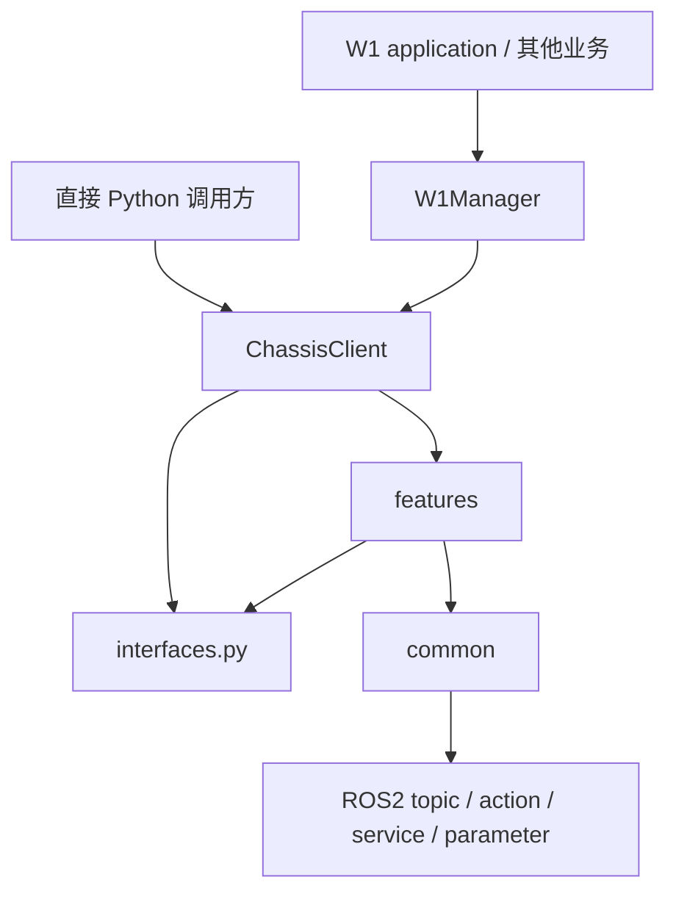
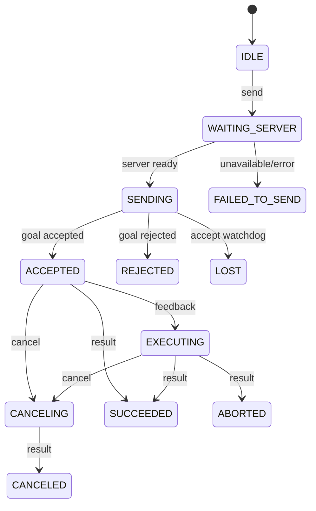

# navigation_client 设计文档（开发侧）

> **适用包版本**：`0.7.1`
> **代码基线**：`xmk/modify_navigation1` 基于 `glf/modify_navigation@4832984` 的当前 rebase 工作树
> **文档集版本**：`1.4.0`
> **模块路径**：`src/dexe_robot_client/navigation_client/`
> **更新日期**：2026-08-04

## 1. 定位与边界

`navigation_client` 是底盘与导航能力的 Python 客户端适配层。它把业务调用转换为 ROS2
topic/action/service/parameter 请求，并把异步结果整理成稳定的 Python 返回值和状态字符串。

它负责：

- 为 `W1Manager` 和直接调用方提供稳定的 `ChassisClient` 门面；
- 隔离真实/仿真的 ROS 接口差异；
- 统一 action 发送、取消、状态、超时、过期回调和延迟诊断；
- 缓存底盘位姿、电量和障碍物状态；
- 提供随包交付的自动接口自测入口。

它不负责：

- 路径规划、控制算法、定位或 TF 生成；
- W1 application 的任务编排与 UI 行为；
- 把 mock 自测结果外推为 PC2、W1Manager、真实运动或回充验收通过。

## 2. 目录与依赖

```text
navigation_client/
├── __init__.py
├── chassis_client.py            # 唯一公开门面；36 个公开方法（含生命周期）
├── interfaces.py                # REAL / SIM 接口配置
├── interface_test.py            # RC-A-01～RC-A-16 runner
├── test_support/
│   └── mock_chassis.py          # 进程内 ROS2 mock peers
├── common/
│   ├── action_task_client.py    # action 生命周期模板
│   ├── runtime.py               # Executor 感知的 spin/future 等待
│   ├── service_caller.py        # 同步 service 调用封装
│   ├── states.py                # TaskState
│   ├── timing.py                # 诊断开关与检查点格式
│   └── validation.py            # 位姿输入校验
├── features/
│   ├── chassis_state.py
│   ├── nav2_navigation.py
│   ├── road_navigation.py
│   ├── graph_points_navigation.py
│   ├── nav_points.py
│   ├── precise_control.py
│   ├── auto_charging.py
│   └── nav2_params.py
└── docs/                        # 本交付文档集、版本清单和一致性检查
```



依赖方向保持 `ChassisClient → features → common`。各 feature 互不依赖；模块内部
`navigation_client/common` 也不依赖顶层 `dexe_robot_client/common`。

## 3. 分层职责

| 层 | 主要职责 | 不应包含 |
|---|---|---|
| `interfaces.py` | 声明 REAL/SIM 的 ROS 名称 | action 生命周期或业务逻辑 |
| `common/` | 状态机、调用模板、Executor、校验、时序 | 某个具体业务 goal 的字段拼装 |
| `features/` | 输入校验、goal/request 构造、状态兼容映射 | 跨 feature 编排 |
| `chassis_client.py` | 组合 feature、稳定公开 API、触发时刻打点 | 规划控制算法或重复通信流程 |
| `interface_test.py` | 自动接口契约验证与证据输出 | 真实运动、人工判断和现场安全授权 |

`ChassisClient` 当前共有 36 个非私有方法：3 个生命周期/执行器方法和 33 个业务门面方法。
维护者新增公开能力时，应先判断它是否需要屏蔽多步 ROS 流程；单一原生 topic 数据若不需要
状态缓存、兼容映射或组合调用，不应为了“统一”而机械地再包一层。

## 4. 当前 ROS 接口配置

### 4.1 REAL

| 类别 | 名称 | 类型/用途 |
|---|---|---|
| Topic 输入 | `/feedback/chassis_pose` | `geometry_msgs/PoseStamped`，位姿与连接新鲜度 |
| Topic 输入 | `/diagnostics_agg` | `diagnostic_msgs/DiagnosticArray`，电量 |
| Topic 输入 | `obstacle_detector/has_obstacle` | `std_msgs/Bool`，前障碍物 |
| Action | `navigate_to_pose` | `nav2_msgs/NavigateToPose` |
| Action | `/navigate_through_poses` | `nav2_msgs/NavigateThroughPoses`，production 兼容接口 |
| Action | `/navigate_through_graph_points` | `nav_interfaces/NavigateThroughGraphPoints`，按点位名称调度路径 |
| Action | `control/precise_control` | `nav_interfaces/PreciseControl` |
| Action | `/auto_charging` | `chassis_interfaces/AutoCharging` |
| Service | `/map_asset_manager/get_all_nav_points` | `nav_interfaces/GetAllNavPoints` |
| 参数节点 | `/controller_server` | 目标容差、FollowPath 速度上限 |
| 参数节点 | `/local_costmap/local_costmap` | footprint、inflation radius |
| 参数节点 | `/global_costmap/global_costmap` | footprint、inflation radius |

### 4.2 SIM

SIM 配置 `/feedback_sim/chassis_pose`、`control/precise_control` 和
`/controller_server` 参数节点。导航、路网、路径导航、回充和导航点接口名为 `None`，调用时
fail-closed；目标容差按 `current_goal_checker` 的实际参数样式写入并读回校验。

## 5. ActionTaskClient

五类 action feature 复用同一个 `ActionTaskClient`：单点导航、路网导航、路径导航、底盘
精控、自动回充。它管理一个任务从发送到终态的完整生命周期。



关键机制：

- 所有状态转移在锁内完成；
- 每次发送递增 `task_id`，旧任务回调不得更新新任务；
- goal response 由 accept watchdog 约束，超时进入 `LOST`；
- goal 接受前取消会登记 pending-cancel，接受后自动补发；
- 异常必须转成 `FAILED_TO_SEND`/`LOST`，不能只打印日志；
- result success 同时要求 ROS goal 状态成功和 result 自身 `success` 为真。

## 6. Executor 与同步边界

- `standalone=False`：默认模式，由 W1Manager 等外部 `MultiThreadedExecutor` 管理节点。
- `standalone=True`：模块自建后台 executor；调用方必须配对 `close()`。
- 节点已被外部 executor 管理时，`runtime.spin_once()` 不重复 spin，避免一个节点加入多个
  executor。
- action 目标不会等待物理任务完成，但 `send()` 会同步等待 action server，最长为对应
  `wait_server_timeout`。
- 导航点查询和参数写后读校验是同步 service 流程。若从同一 executor 的回调线程调用，
  future 可能因回调无法调度而超时；这类接口应放在独立业务线程或确保有可用执行线程。

## 7. 输入、坐标与状态兼容

| 能力 | 输入 | yaw | frame |
|---|---|---|---|
| 单点导航 | `[x, y, yaw]` | 度 | `map` |
| 精控 | `[x, 0, yaw]`，x/yaw 互斥；y 当前忽略 | 度 | `base_link` |
| 路网导航 | `[[x, y, yaw], ...]` | 弧度 | 默认 `map` |
| 路径导航 | `nav_point_names`；其余 goal 字段可选透传 | `target_yaw` 服从 action 协议，当前服务端未消费 | 服务端解析 |
| 导航点返回 | `(x, y, theta)` | 弧度 | 地图语义 |
| 目标容差 | `xy_tolerance, yaw_tolerance` | yaw 为弧度 | 参数语义 |

内部 action 状态统一使用 `TaskState`；对外仍保留历史字符串，例如导航使用
`NAVIGATING/CANCELLED`，路网、路径导航和回充使用 `EXECUTING/CANCELED`。不得仅为拼写统一而破坏
既有 W1Manager 契约。

## 8. 延迟诊断

五个触发方法记录同一 task_id 的：

```text
触发 → server就绪 → 已发出 → accepted → 进度 → result
```

默认只打印触发和返回；设置 `DEXE_NAV_CLIENT_DIAGNOSTICS=1` 后打印全部检查点。
跨线程日志行顺序不代表事件先后，诊断必须依据各行捕获的 `wall`、`Δ`、`累计` 和 task_id。

## 9. 自动接口自测设计

`interface_test.py` 和 `test_support/mock_chassis.py` 随模块交付。runner 在隔离 ROS domain 中
创建 real/sim 两个 `ChassisClient` 和进程内 peer，通过真实 rclpy topic/action/service/
parameter 通道验证 `RC-A-01～RC-A-16`。runner 默认对每个用例连续执行 15 轮，逐轮使用
`R01～R15` 标识并保存检查点；任一失败轮都会进入机器结果，不能从分母中删除。

当前范围覆盖：底盘状态与断连恢复、单点导航成功/取消、导航点查询、精控成功/取消/非法
输入、回充成功/取消、四类参数写后读、仿真能力边界，以及导航/footprint 的独立拒绝路径。
其中 `RC-A-11` 每轮依次写入四点矩形和六点凸多边形，并分别校验 local/global costmap
精确回读；`RC-A-16` 独立验证三点输入被拒绝且参数不变。

结果 schema v2 同时保存 `repeat_per_case=15`、计划/完成调用数、逐用例汇总以及
240 个逐轮记录。只有全部 16 项均完成 15/15 且无 FAIL/ERROR/PENDING_ENV 时，自动部分
才可形成 `AUTOMATED_PASS`。

制品写入完成后，runner 使用同一份结果 payload 在终端打印最终表格：每个 RC-A 一行，
列出计划、完成、PASS、FAIL、ERROR、PENDING_ENV 和用例结论，末尾 `TOTAL` 行给出总体
状态。表格不重新计算判据，不改变 JSON/Markdown 内容或退出码。

当前正式 RC-A 范围明确不含 `NavigateThroughPoses` 和新加的
`NavigateThroughGraphPoints`。前者是既有范围决定；后者当前只由 examples 下的
standalone `graph` 分组覆盖发送、结果和取消，尚未进入 15 轮正式统计。production feature
与公开方法不能因未进入 RC-A 就删除。

mock PASS 只证明开发机 fixture 契约。PC2 同步、W1Manager、真实定位/运动/回充和 W1
application 操作仍需分别执行并保留证据。

## 10. W1Manager 契约

当前源码调用面包括 `move_chassis_nav2`、`move_chassis_road_navigation`、
`move_chassis_ctrl`、底盘状态读取、导航/路网/精控状态、导航点、自动回充、统一取消和 Nav2
参数设置。本分支暂未增加 W1Manager 的路径导航发送门面，但
`cancel_chassis_motion()` 已扩展为同时尝试取消单点导航、路网导航、路径导航、精控和回充；
只要一个取消请求成功即返回成功。

因此，接口删除必须以当前消费方搜索和影响分析为前置；不能根据某一测试项被删除推断
production 方法也可删除。

## 11. 已知限制

- 单点导航/精控用度，路网/导航点/参数用弧度，单位尚未统一；
- SIM 能力覆盖位姿、精控和 controller 目标容差；仿真端精控 server 的目标环境验证仍待完成；
- 路径导航当前只有 examples standalone 回归，尚未纳入正式 RC-A 15 轮与 PC2/目标机验收；
- 同步 service 不适合占用唯一的 executor 回调线程；
- 目标机器人自测和 application 手动验收尚未由本地文档检查替代。

## 12. 版本维护

本文件遵守 [README.md](README.md) 的版本绑定规则。公开方法、接口配置和 `RC-A` 目录的
规范化摘要会进入 `version_manifest.json` 的 SHA-256 指纹；发布前运行 `check_docs.py`。
指纹变化代表正文需要人工复核，不允许只更新指纹绕过文档更新。
